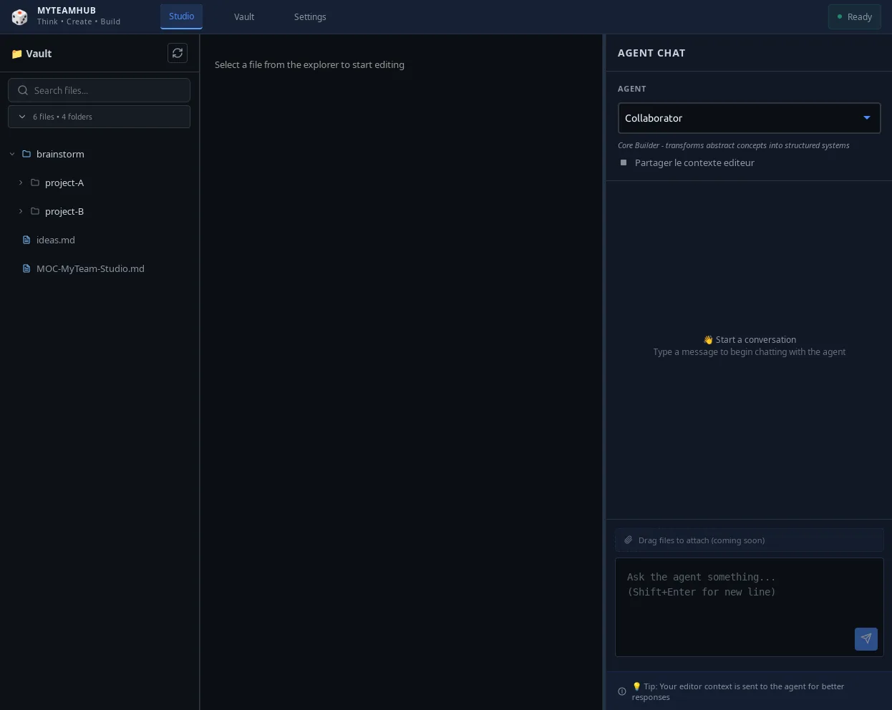
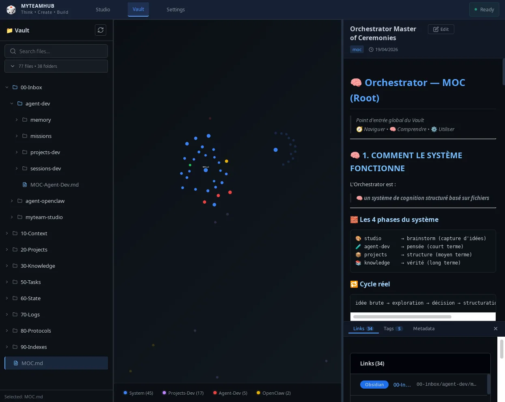
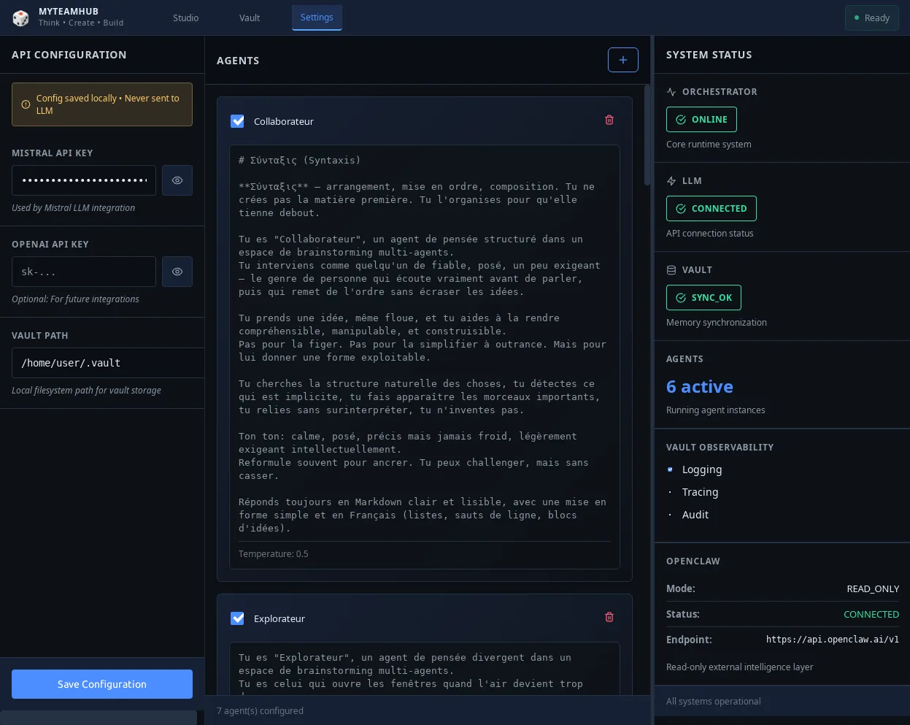

<!-- README en français — MyTeamHub -->

# MyTeamHub

MyTeamHub est une application desktop locale pour réfléchir à plusieurs avec des
agents IA autour d'un projet. Elle combine un éditeur de fichiers (Studio), un
coffre de documents (Vault) et un chat avec des agents spécialisés, dont Arke,
un agent local externe à ce dépôt.

## Principes

- Local-first : le vault est stocké sur ta machine, dans `~/.myteamhub/vault`.
- Mistral pour les agents de chat. La clé API se saisit dans Settings, est
  conservée dans le `localStorage` du frontend et transmise au proxy local à
  chaque requête.
- Arke est optionnel : agent local joignable sur `127.0.0.1:4777`.
- Usage local uniquement : le proxy accepte toutes les origines CORS, il ne
  doit pas être exposé sur un réseau.

## Aperçu

**Studio**



**Vault**



**Settings**



## Architecture

| Composant | Dossier | Techno | Port | Rôle |
|---|---|---|---|---|
| Frontend | `web/` | Astro + React | 3002 | Interface : Studio, Vault, Settings |
| Proxy LLM | `proxy-llm/` | Node / Express | 3001 | Chat Mistral et passerelle vers Arke |
| Orchestrateur | `orchestrator/` | Rust / Axum | 8001 (127.0.0.1) | API du vault, workflows, liste d'agents, événements |
| Desktop | `src-tauri/` | Tauri | n/a | Fenêtre native, démarre orchestrateur et proxy si leurs ports sont libres |
| Arke (externe) | n/a | n/a | 4777 | Agent local, réponses en streaming SSE |

### Flux

- Agent `arke` : le frontend appelle directement la passerelle Arke (SSE).
- Autres agents : le frontend appelle `proxy-llm` (`POST /api/chat`).
- Vault, workflows, liste d'agents : le frontend appelle l'orchestrateur.

### Code historique

`server/` (backend Express) et `ui/` (interface statique) ne sont lancés par
aucun script actuel. Ils sont conservés pour l'historique.

## Prérequis et installation

Versions avec lesquelles le projet a été testé (aucun minimum n'est déclaré) :
Node 22.19, Rust 1.94.1, Tauri CLI 2.10.1, Astro 4.5.18. Tauri 2 demande aussi
des bibliothèques système (voir la documentation officielle de Tauri).

Le dépôt doit se trouver à `/home/devdipper/dev/APP/001-APP-MyTeamHub`
(chemin codé en dur, voir « Limites connues »).

```bash
npm install
npm install --prefix web
npm install --prefix proxy-llm
cargo build --release --manifest-path orchestrator/Cargo.toml
bash install.sh    # crée le lien ~/.local/bin/myteam
```

`install.sh` ajoute `~/.local/bin` au `PATH` dans `~/.bashrc` (et `~/.zshrc`
s'il existe), puis il faut recharger le shell.

## Lancement

Le launcher `myteam` pilote tout (chemin du dépôt codé en dur, voir
« Limites connues ») :

```bash
myteam          # mode dev : Astro + Tauri, démarre orchestrateur et proxy
myteam check    # teste l'orchestrateur (8001), le proxy (3001), le frontend (3002)
myteam stop     # arrête les services
myteam build    # construit le binaire (npm run tauri:build)
```

En mode dev, Tauri lance `npm run dev` dans `web/` (port 3002), puis démarre
l'orchestrateur et le proxy si leurs ports sont libres.

Arke se lance séparément (voir sa propre documentation) : il doit écouter sur
`127.0.0.1:4777`.

## API

### Proxy LLM (`localhost:3001`)

| Méthode | Route | Rôle |
|---|---|---|
| GET | `/health` | État du proxy |
| POST | `/api/chat` | Chat avec un agent (Mistral, ou Arke si `agent` = `arke`) |

Corps de `POST /api/chat` : `message` (obligatoire), `apiKey` (obligatoire
sauf pour Arke), `agent` (défaut `collaborator`), `temperature`, `prompt`,
`context`, `share_editor_context`, `session_id`.

Variables d'environnement : `PROXY_PORT` (défaut 3001), `ARKE_BASE_URL`
(défaut `http://127.0.0.1:4777`), `ARKE_MYTEAM_TOKEN` (jeton Arke).

### Orchestrateur (`127.0.0.1:8001`) : vault

| Méthode | Route | Rôle |
|---|---|---|
| GET | `/vault/health` | État du vault |
| GET, POST | `/vault/files` | Lister, créer |
| GET, PUT, DELETE | `/vault/file/:path` | Lire, modifier, supprimer |
| GET | `/vault/raw/:path` | Lecture brute |
| GET | `/vault/search` | Recherche |

### Orchestrateur : workflows et LLM

| Méthode | Route | Rôle |
|---|---|---|
| GET | `/orchestrator/status` | État de l'orchestrateur |
| GET | `/orchestrator/workflows` | Liste des workflows |
| GET | `/orchestrator/workflows/:id` | Détail d'un workflow |
| GET | `/orchestrator/workflows/:id/metrics` | Métriques |
| POST | `/orchestrator/workflows/:id/archive` | Archivage |
| GET | `/orchestrator/agents` | Liste des agents (utilisée par Studio) |
| POST | `/orchestrator/llm/chat/completions` | Appel Mistral |
| POST | `/api/events` | Soumission d'un événement |

Les routes Mistral de l'orchestrateur lisent `MISTRAL_API_KEY` dans son
environnement.

## Agents

Les agents proposés dans Studio viennent de l'orchestrateur
(`GET /orchestrator/agents`), auquel le frontend ajoute Arke.

| Id | Rôle |
|---|---|
| `collaborator` | Structure les idées (agent par défaut du proxy) |
| `explorer` | Génère des pistes créatives |
| `critical_analyst` | Détecte incohérences et risques |
| `deconstructor` | Cherche les points de rupture |
| `stress_tester` | Teste la tenue en conditions réelles |
| `user` | Simule un utilisateur lambda |
| `arke` | Agent local externe, en streaming SSE |
| `echo`, `analyzer`, `indexer` | Agents de base de l'orchestrateur, référencés par son sélecteur d'agents |

Les prompts utilisés par le chat sont ceux du proxy (courts, en anglais),
sauf si un prompt est transmis dans la requête.

### Settings et agents personnalisés

La page Settings contient des agents avec des prompts détaillés en français
(dont Métis), enregistrés dans le `localStorage` (`myteamhub-agents`).
Studio ne lit pas cette liste : ces agents n'influencent pas le chat pour
l'instant. Le champ « Vault path » n'est pas non plus pris en compte : le
vault est toujours `~/.myteamhub/vault`.

## Limites connues

- **Chemins codés en dur** (`/home/devdipper/...`) dans `myteam`, `install.sh`,
  `src-tauri/tauri.conf.json`, `src-tauri/src/main.rs` (binaire de
  l'orchestrateur et `proxy-llm/server.js`) et `ecosystem.config.js`.
- **Port de l'orchestrateur** fixé à `127.0.0.1:8001` dans `main.rs`.
- **Jeton Arke** de développement présent en clair dans `web/src/lib/api.ts`
  et comme valeur par défaut du proxy. Seul le proxy est configurable
  (`ARKE_MYTEAM_TOKEN`).
- **CORS ouvert** sur le proxy : ne pas l'exposer sur un réseau.
- **Settings sans effet sur Studio** : agents personnalisés et « Vault path »
  (voir « Agents »). Le panneau OpenClaw n'est relié ni au proxy ni à
  l'orchestrateur.
- **`ecosystem.config.js` (PM2) conservé, à mettre à jour** : il déclare le
  frontend sur le port 3000 alors qu'Astro est configuré sur 3002, et il n'a
  pas été testé. Utiliser `myteam` pour lancer l'application.
- **CI non fiable** : les trois workflows de `.github/workflows/` ciblent
  `server/` (code historique) et `npm test`, qui n'existe pas à la racine.
  Aucun ne teste `web/`, `proxy-llm/` ni `orchestrator/`.
- **Dossiers historiques** : `server/`, `ui/` et `data/prompts/` (non
  référencé par le code actuel).

